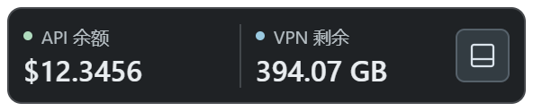

# Usage Monitor

一个小巧的 Windows 桌面悬浮窗，同时查看 **To-Tokens API 余额**和 **FlowerCloud VPN 剩余流量**。



## 使用

在本仓库的 **Releases** 中下载 Windows x64 便携 EXE，放在固定目录后双击运行，无需安装 Node.js。

1. 点击右侧详情按钮，在 API 用量与 VPN 流量页签之间切换。
2. 点击当前页签底部的「账户」，在网站官方登录页面完成登录。关闭账户窗口后自动同步，也可以点击「刷新」。
3. 再次点击详情按钮收起；靠屏幕底部时向上展开，按钮留在原位置。

两个网站分别登录。程序使用自己的持久浏览器会话，与 Chrome、Edge 或 Codex 内置浏览器的登录状态独立。

## 功能

- API 余额、今日实际消费、调用次数、输入/输出 Token、模型用量和最近调用。
- VPN 剩余流量、周期已用/总量、上传/下载、重置日和到期日。
- 每分钟同步，支持手动刷新；失败时保留上次成功值并显示更新时间。
- 窗口置顶、拖动、屏幕边缘磁吸；保存上次位置。
- 任意位置右键或托盘菜单：显示/隐藏、开机启动、账户、刷新和退出。
- 固定页签与底部操作栏，内容滚动；Esc 收起，方向键切换页签。

隐藏窗口后仍会同步；「退出」才会关闭程序。开启自启动前请将 EXE 放在固定目录，移动文件或更换版本后关闭再开启自启动以更新路径。

## 数据与登录

查询通过网站自己的用户接口或已登录的套餐页面完成。VPN 流量是网站计量结果，不是本机瞬时网络速率；页面本身的计量延迟会反映到显示值。

API 查询使用 `Asia/Shanghai` 当日范围，金额沿用网站美元单位。VPN 单位按 1024 进制转换为 GB，当前读取第一个激活套餐。网站接口或页面结构改变后可能需要更新适配。

账户会话保存在当前 Windows 用户的应用数据目录中。API 会话备份使用 Electron `safeStorage` 的 Windows 加密机制保存，仅用于本机恢复；登录凭证不进入源码仓库。会话被网站撤销或过期后需要重新登录。

VPN 登录成功后，网站签发的会话 Cookie 会被补上一个长期有效期，由 Electron 存在本机分区目录中，因此关闭程序或重启电脑后登录状态仍在。补有效期只影响本机能保存多久，不改变网站服务器端的会话长度。

要长期保持登录，请在账户窗口登录时**勾选「记住我」**。真正支撑长期登录的是网站签发的 `WHMCSUser`（有效期一年）；不勾选则只有短会话，过期后需要重新登录。

网站可能开启会话 IP 校验：IP 地址变化（连接或断开 VPN、切换节点、更换网络）时服务器会作废会话，表现为需要重新登录。这是网站侧策略，客户端无法绕过；若频繁遇到，可联系服务商关闭该检查。

为了兼容之前的两个独立插件，使用以下本地目录：

- `%APPDATA%\totokens-monitor\Partitions\totokens` 与 `%APPDATA%\totokens-monitor\session.bin`
- `%APPDATA%\flowercloud-monitor\Partitions\flowercloud`（VPN 登录 Cookie 由该分区的 Cookie 库直接保存）
- `%APPDATA%\desktop-usage-monitor\window-position.json`

## 从源码运行

需要 Windows 10/11 x64、Node.js 22 或更高版本。

```powershell
npm ci
npm start
```

依赖版本通过 lockfile 固定。Lucide 图标在安装后复制到本地，运行界面不依赖图标 CDN。

## 测试与构建

```powershell
npm test
npm run test:parser
npm run pack
```

测试使用模拟数据和隔离的浏览器目录，不登录真实账户。解析和刷新控制测试覆盖超时恢复、重试、跳转套餐页与流量日期解析；界面在开发时用隔离窗口检查。

便携 EXE 输出至 `dist/`。正式构建也由 GitHub Actions 在 Windows 上执行；推送 `v*` 标签后会在 Release 中附上 EXE 与 SHA-256 校验文件。

## 故障排查

- 显示「请登录」：打开对应账户窗口登录，完成后关闭该窗口。
- 同步失败：查看状态提示，重试刷新，或在账户窗口完成网站验证。
- 自启动找不到程序：在新 EXE 的菜单里关闭再开启「开机启动」。
- 修改代码或更新程序时，请先退出旧版；同时运行多个版本可能共用账户浏览器目录。

这是个人开发的客户端工具，与两个服务商无隶属关系。

## 许可

项目源码采用 MIT 许可证。Electron、electron-builder 和 Lucide 的许可证与说明见 [THIRD_PARTY.md](THIRD_PARTY.md)。
